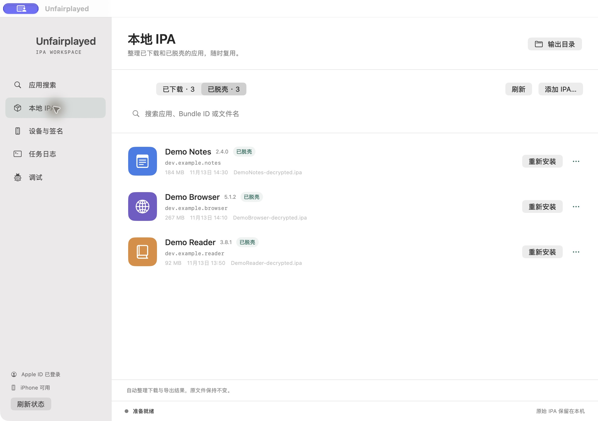
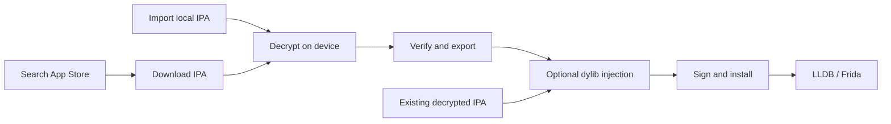
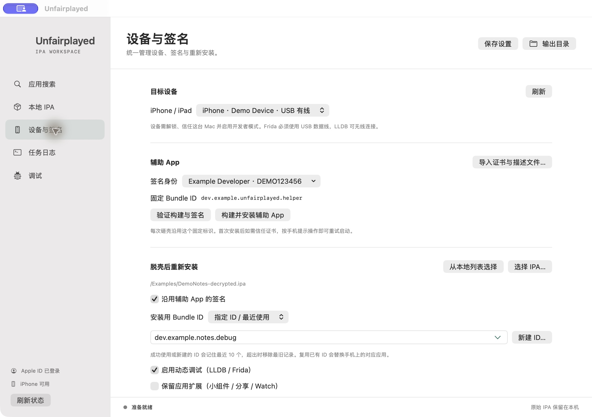
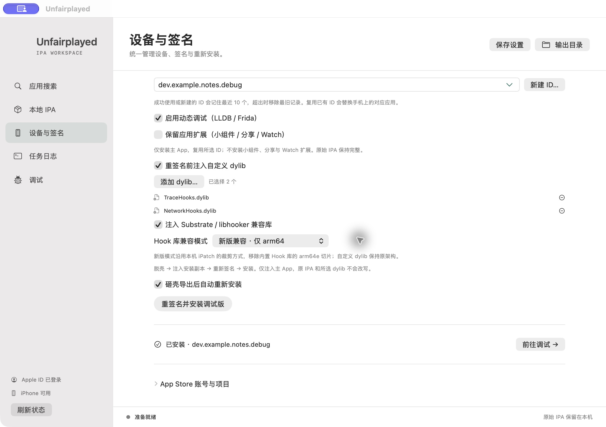
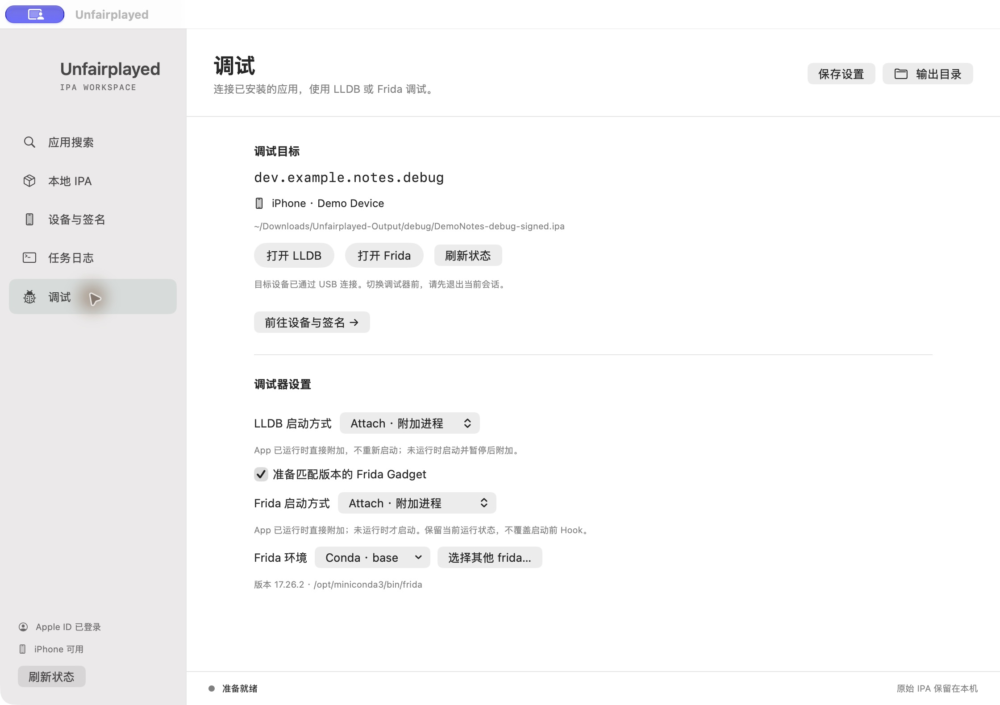

<p align="center">
  
</p>
<h1 align="center">Unfairplayed</h1>
<p align="center"><strong>From the App Store to your debugger. Decrypt, inject, sign, and install.</strong></p>
<p align="center">Native macOS app · On-device decryption · Custom dylibs · LLDB &amp; Frida</p>
<p align="center">
  <a href="README.md">简体中文</a> · <strong>English</strong>
</p>
<p align="center">
  
  
  
</p>
<p align="center">
  <a href="#installation">Installation</a> · <a href="#quick-start">Quick start</a> · <a href="#dylib-injection">Injection</a> · <a href="#dynamic-debugging">Debugging</a> · <a href="#faq">FAQ</a>
</p>



**Unfairplayed** brings App Store search, IPA downloads, on-device decryption, dylib injection, signing, installation, and debugging into one workspace. Built with SwiftUI and powered by the jailbreak-free decryption core from [FairPlayed](https://github.com/morzelowski/FairPlayed), it keeps your device, signing identity, artifacts, and logs in view throughout the workflow.

> Screenshots show the native interface with sample apps, devices, and signing identities. The current app interface is in Chinese; this documentation is available in Chinese and English.

## Highlights

| Feature | What you get |
| --- | --- |
| **Search & download** | Find App Store apps by name or Bundle ID, view icons and metadata, and download IPAs through ipatool. |
| **Local IPA library** | Browse downloaded and decrypted apps separately, search, drag in files, add multiple IPAs, and reinstall from the list. |
| **On-device decryption** | Automate embedding, building, signing, installation, export, and Mach-O encryption flag verification. |
| **Devices & signing** | Select an Xcode team or import multiple P12 certificates and provisioning profiles, with device and validity checks. |
| **Bundle ID management** | Keep a fixed helper ID; reuse, specify, or create an installation ID, with the 10 most recent IDs remembered. |
| **dylib injection** | Add multiple custom libraries before signing, with optional Substrate / libhooker compatibility libraries. |
| **Dynamic debugging** | A dedicated page for LLDB Attach / Launch, Frida Attach / Spawn, and environment selection. |
| **Persistent task logs** | Write complete logs to disk as tasks run, restore previous logs, and export them at any time. |



## Installation

### 1. Prepare your environment

| Component | Requirement |
| --- | --- |
| Mac | Apple Silicon, macOS **15.0+** |
| Xcode | Full Xcode installation with the iOS SDK and first-launch components installed |
| Python | Python 3; the backend uses the standard library |
| iPhone / iPad | Paired with and trusting your Mac, Developer Mode enabled, kept unlocked during tasks |
| Signing | An Xcode developer account, or a P12 containing a private key and a provisioning profile for your device |
| App Store downloads | ipatool and an Apple ID that owns the target app; use the corresponding account on the device |
| Dynamic debugging | A development profile with `get-task-allow`; USB for Frida |

For decryption, sign in on the device with the Apple ID that owns the target app. The current device validation environment is **iOS 27.0.1**.

In Xcode → Settings → Locations, set **Command Line Tools** to your full Xcode installation.

### 2. Install the desktop app

Download `Unfairplayed-macOS-arm64.zip` from **Releases** on this project's GitHub page. Extract it, drag `Unfairplayed.app` into Applications, and open it.

The app includes the helper app source, scripts, signing helper, and Hook runtime libraries. It prepares its working directory automatically on first launch.

If macOS displays a developer verification prompt, open System Settings → Privacy & Security and choose **Open Anyway**.

<details>
<summary><strong>Build from source</strong></summary>

Choose **Code → Download ZIP** on the repository page, or download the `Unfairplayed-Source.zip` release asset. Extract it and run these commands from the source directory:

```bash
./build_desktop.sh --install
open "$HOME/Applications/Unfairplayed.app"
```

You can also double-click `Unfairplayed.command`. To build without installing, run `./build_desktop.sh`; the app is written to `desktop/build/Unfairplayed.app`.

</details>

### 3. Add download and debugging tools

For App Store downloads, install [ipatool](https://github.com/majd/ipatool):

```bash
brew install ipatool
```

For Frida, install [frida-tools](https://frida.re/docs/installation/) in your preferred Python or Conda environment:

```bash
python3 -m pip install frida-tools
```

Select that environment on the Debugging page. The default prefers Conda `base`; other Conda environments, local installations, and a custom `frida` executable are also supported. LLDB is included with Xcode.

## Quick start

### ① Connect your device and select signing

Open **Devices & Signing** (设备与签名), choose your iPhone / iPad and signing identity, and save. For an initial check, select **Verify Build & Signing** (验证构建与签名).

- **Xcode team:** choose a signed-in team from the dropdown.
- **Your certificates:** select **Import Certificates & Profiles** (导入证书与描述文件…), choose a folder containing P12 files and `.mobileprovision` profiles, and enter the certificate password. Multiple sets are supported.
- **Fixed helper ID:** generated once and reused for decryption; the app you reinstall can use a separate Bundle ID.



### ② Download or import an IPA

Search by app name or Bundle ID on **App Search** (应用搜索). Select **Sign in to Apple ID** (登录 Apple ID…), complete password and two-factor authentication in Terminal, then return to the app and refresh.

Choose **Download & Decrypt** (下载并砸壳) for the full workflow, or **Download Encrypted IPA Only** (仅下载加密 IPA) to download first. Existing files can be added or dragged into **Local IPAs** (本地 IPA) and processed from the list.

### ③ Decrypt and export

Keep the device unlocked. Unfairplayed builds and installs the helper, runs it, exports the result, and verifies the output. **Task Logs** (任务日志) shows progress while the complete log is written to disk.

When installing a development-signed app for the first time, follow the prompt to trust the developer under Settings → General → VPN & Device Management on your device, then choose **Trusted, Retry Launch** (已信任，重试启动). After export, choose whether to keep or uninstall the helper.

### ④ Sign and install

Select **Reinstall** (重新安装) beside a decrypted IPA, or choose a file on Devices & Signing.

1. Reuse the helper's signing identity or select one for the installation copy.
2. Reuse the helper ID, enter a custom ID, choose a recent ID, or create one.
3. Choose dynamic debugging, extension preservation, and dylib injection as needed, then install.

**A separate Bundle ID lets the app coexist with the original. Reusing an ID replaces the app installed with that ID.** The 10 most recently used IDs are remembered and deduplicated; removing an old entry changes only the local list. The default installs the main app. Enable **Preserve App Extensions** (保留应用扩展) to include widgets, share extensions, and other extensions.

Enable **Automatically Reinstall After Export** (砸壳导出后自动重新安装) to continue with these settings after decryption.

### ⑤ Open a debugger

After installation with a debugging-enabled profile, Unfairplayed opens the dedicated **Debugging** (调试) page. Choose a startup mode, then select **Open LLDB** or **Open Frida** to start a Terminal session.

## dylib injection

Under Devices & Signing → Reinstall After Decryption, enable **Inject Custom dylibs Before Signing** (重签名前注入自定义 dylib). Add one or more `.dylib` files and optionally include the bundled Substrate / libhooker compatibility libraries.



| Compatibility mode | Bundled Hook runtime behavior |
| --- | --- |
| **Modern** | Default. Keeps only the `arm64` slice. |
| **Legacy** | Retains the original universal `arm64 + arm64e` libraries. |

The mode applies to the bundled Hook runtime; custom dylibs keep their own architectures. Injection modifies the main app's installation copy, which is then signed. Source IPAs and selected dylib files remain unchanged.

See [InjectionRuntime](desktop/InjectionRuntime/README.md) for runtime provenance, architecture details, and licenses.

## Dynamic debugging



| Debugger | Mode | Behavior | Connection |
| --- | --- | --- | --- |
| **LLDB** | Attach | Attaches to a running app and preserves its PID; otherwise starts it suspended and attaches. | USB / Wi-Fi |
| **LLDB** | Launch | Restarts the app and pauses early in startup. | USB / Wi-Fi |
| **Frida** | Attach | Attaches to a running app; otherwise launches it before attaching. | USB |
| **Frida** | Spawn | Starts the app through Frida for startup instrumentation. | USB |

- In LLDB, enter `continue` or `c` to resume execution.
- Select your Frida environment in the UI. Unfairplayed prepares the official Gadget matching that version.
- A profile containing `get-task-allow` enables the dynamic debugging option. Distribution profiles can also be used for regular installations.
- Connecting through USB enables Frida. LLDB also supports Wi-Fi. Exit the current session before switching debuggers.

Each installation saves its own session and launch scripts, which you can reopen from the output directory.

## Output and local data

All artifacts are written to:

```text
~/Downloads/Unfairplayed-Output/
├── downloads/                    Original downloaded IPAs
├── <App>-decrypted.ipa           Decrypted output
├── debug/
│   └── <timestamp>-<id>/          Signed IPA, session, and debugger scripts
├── logs/                         Complete task logs, saved per run
├── build.log                     Latest build log
└── export-<App>.txt              Device export log
```

The local IPA library can reference existing files for convenient browsing and reuse. Export a complete task log while a task is running, or reopen the app to recover an unfinished task's log. Save a copy of an exported IPA before processing another app with the same name if you want to retain both results.

Configuration and signing materials live in `~/Library/Application Support/Unfairplayed/`. The desktop workspace configuration is `Workspace/.unfairplayed.env`. Imported private keys are stored in a dedicated keychain; ipatool manages Apple ID authentication.

## Command line

The source tree also includes command-line tools:

```bash
# Build the helper and verify signing
./fpdecrypt.sh --build-only

# Build and install the helper
./fpdecrypt.sh --install-only

# Decrypt a local IPA
./fpdecrypt.sh "/path/to/App.ipa"

# Download and decrypt
./fpdecrypt.sh --download com.example.app

# Check encryption flags for every Mach-O architecture in the IPA
./verify_ipa.sh "$HOME/Downloads/Unfairplayed-Output/App-decrypted.ipa"
```

See [`.unfairplayed.env.example`](.unfairplayed.env.example) for CLI configuration and the [usage guide](使用说明.md) for detailed steps in Chinese.

## FAQ

<details>
<summary><strong>Why does the first ipatool login stay at preparing authentication?</strong></summary>

Initial authentication prepares Apple's authentication components and can take several minutes. Keep Terminal open and watch for further output. See the [first-login guide](使用说明.md#首次登录与连接) for authentication and connectivity steps in Chinese.

</details>

<details>
<summary><strong>The device asks me to trust the developer after installation.</strong></summary>

On your device, open Settings → General → VPN & Device Management → Developer App and trust or verify the developer. Keep the device unlocked, then select **Trusted, Retry Launch** in the desktop dialog to continue the current export.

</details>

<details>
<summary><strong>How do I enable dynamic debugging?</strong></summary>

Choose a development profile containing `get-task-allow`, enable dynamic debugging, and reinstall. Available signing identities are filtered by device and validity; the debugging toggle updates automatically according to the selected profile.

</details>

<details>
<summary><strong>How do I reuse a Bundle ID?</strong></summary>

Choose **Reuse Helper App ID** (复用辅助 App ID), or select a saved ID under **Custom ID / Recent** (指定 ID / 最近使用). To create one, select **New ID** (新建 ID…): Xcode teams provision an App ID and development profile for the device, while imported signing materials use a local ID matched to the appropriate profile.

</details>

## Development and contributions

Issues and pull requests are welcome for workflow improvements, compatibility, and documentation. For bug reports, include reproduction steps, system versions, and relevant log excerpts.

```bash
# Build the desktop app
./build_desktop.sh

# Generate app and source archives, SHA-256 checksums, and release checks
./package_release.sh
```

Release artifacts are written to `desktop/dist/`. See the [development guide](docs/DEVELOPMENT.md) for project structure and regression checks, and the [release guide](docs/PUBLIC_RELEASE.md) for packaging. These detailed guides are currently in Chinese.

## Acknowledgments

- [FairPlayed](https://github.com/morzelowski/FairPlayed) — on-device decryption core.
- [ipatool](https://github.com/majd/ipatool) — App Store authentication and IPA downloads.
- [iPatch](https://github.com/EamonTracey/iPatch) — injection reference and source of the bundled Hook runtime libraries.
- [libhooker](https://github.com/coolstar/libhooker) — Hook compatibility runtime.
- [Frida](https://frida.re/) — dynamic instrumentation tools and Gadget.

This product includes software developed by CoolStar.

[Original upstream documentation](docs/UPSTREAM.md) · [Runtime licenses and provenance](desktop/InjectionRuntime/README.md) · [Icon assets](desktop/Assets/README.md)
