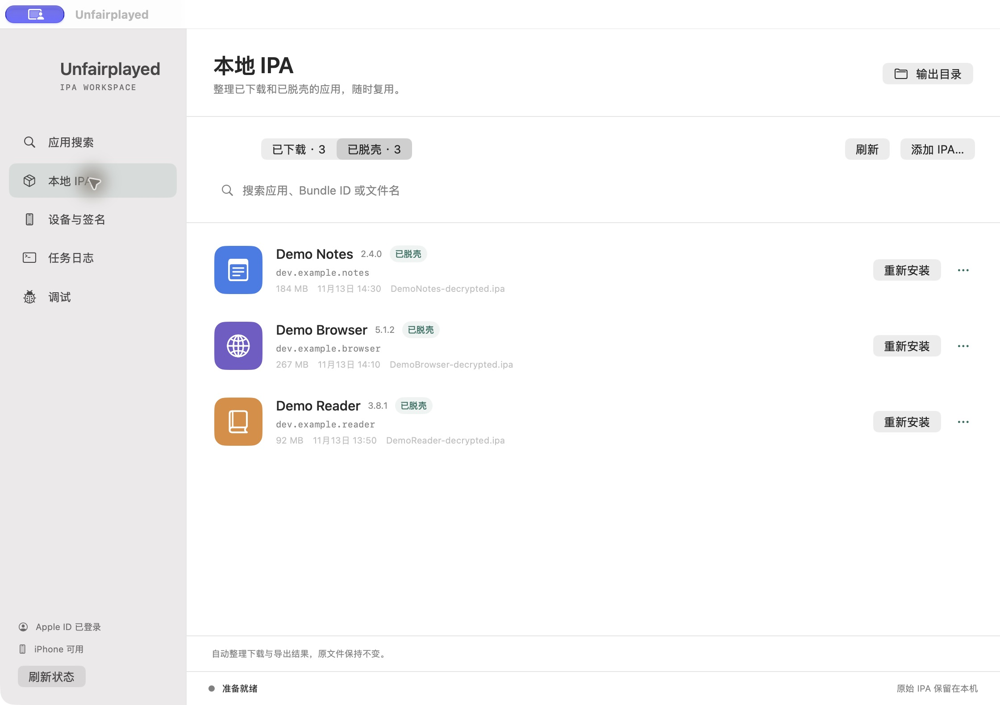
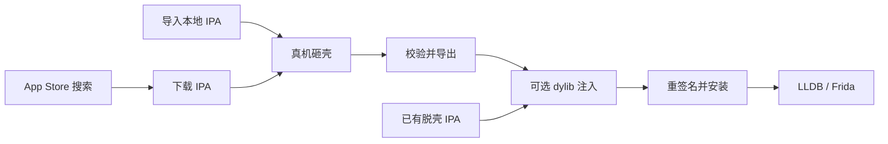
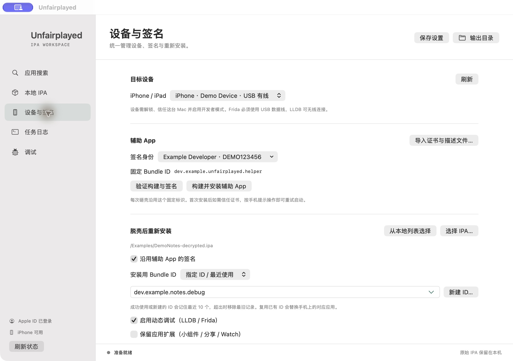
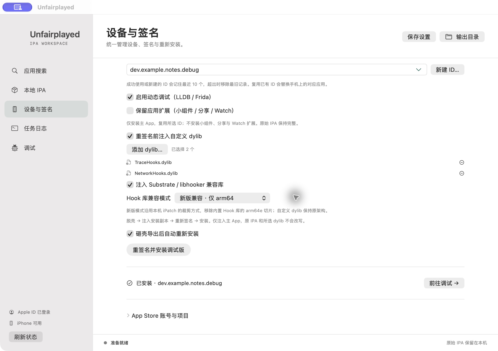
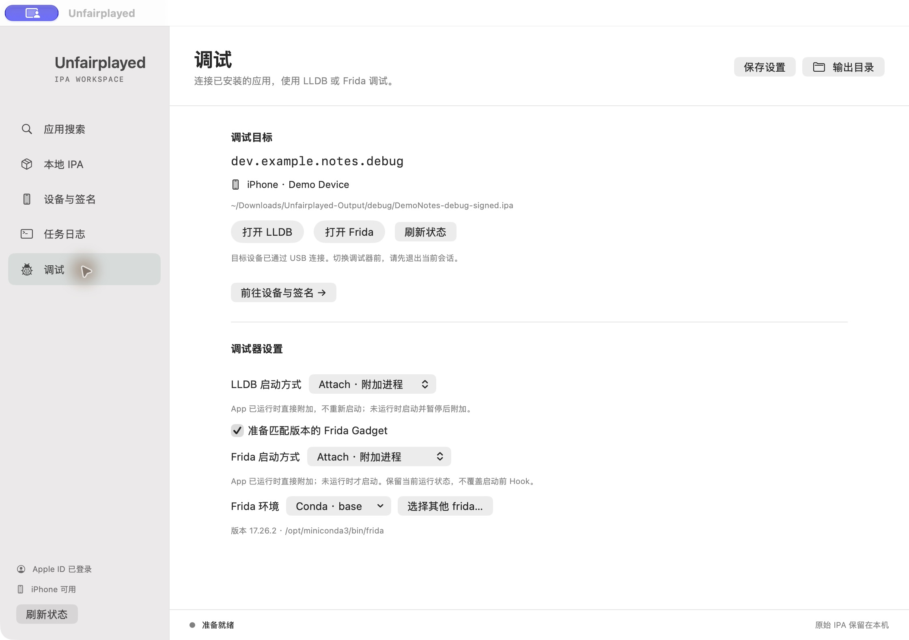

<p align="center">
  
</p>
<h1 align="center">Unfairplayed</h1>
<p align="center"><strong>从 App Store 到调试器，一站完成 iOS 应用砸壳、注入与重签名。</strong></p>
<p align="center">原生 macOS 界面 · 真机砸壳 · 自定义 dylib · LLDB &amp; Frida</p>
<p align="center">
  <strong>简体中文</strong> · <a href="README.en.md">English</a>
</p>
<p align="center">
  
  
  
</p>
<p align="center">
  <a href="#安装">安装</a> · <a href="#快速开始">快速开始</a> · <a href="#注入动态库">动态库注入</a> · <a href="#动态调试">动态调试</a> · <a href="#常见问题">常见问题</a>
</p>



**Unfairplayed** 将应用搜索、IPA 下载、真机砸壳、动态库注入、重签名安装和动态调试串联在一个工作空间里。基于 [FairPlayed](https://github.com/morzelowski/FairPlayed) 的免越狱砸壳核心，使用 SwiftUI 构建桌面界面，让每一步的设备、签名、产物和日志都清晰可见。

> 截图来自原生界面，应用、设备与签名信息为演示数据。当前界面语言为中文，本文档提供中英文版本。

## 功能亮点

| 功能 | 使用体验 |
| --- | --- |
| **搜索与下载** | 按应用名称或 Bundle ID 检索 App Store，查看图标、版本和开发者；集成 ipatool 下载 IPA。 |
| **本地 IPA 库** | 已下载与已脱壳分开展示，支持搜索、拖入、批量添加和直接重新安装。 |
| **真机砸壳** | 自动完成嵌入、构建、签名、安装、导出与 Mach-O 加密标记校验。 |
| **设备与签名** | 下拉选择 Xcode 团队，或批量导入 P12 与描述文件；按设备与有效期筛选可用签名。 |
| **Bundle ID 管理** | 辅助 App 使用固定 ID；重装时可复用、指定或新建 ID，记忆最近 10 个。 |
| **dylib 注入** | 重签名前注入多个自定义动态库，按需加入 Substrate / libhooker 兼容库。 |
| **动态调试** | 独立调试页，支持 LLDB Attach / Launch、Frida Attach / Spawn 和环境切换。 |
| **完整任务日志** | 运行期间持续写入磁盘，支持历史恢复、日志另存和输出目录直达。 |



## 安装

### 1. 准备环境

| 项目 | 要求 |
| --- | --- |
| Mac | Apple Silicon，macOS **15.0+** |
| Xcode | 完整 Xcode 与 iOS SDK，已完成首次启动的组件安装 |
| Python | Python 3，后端使用标准库 |
| iPhone / iPad | 已配对并信任 Mac、启用开发者模式，操作时保持解锁 |
| 签名 | Xcode 中的开发者账号，或包含私钥的 P12 与适用于目标设备的描述文件 |
| App Store 下载 | ipatool，以及拥有目标应用许可的 Apple ID；手机登录对应账号 |
| 动态调试 | 含 `get-task-allow` 权限的开发描述文件；Frida 使用 USB 连接 |

砸壳时，设备需登录拥有目标应用许可的 Apple ID。当前真机验证环境为 **iOS 27.0.1**。

在 Xcode → Settings → Locations 中，将 **Command Line Tools** 设为已安装的完整 Xcode。

### 2. 安装桌面应用

从本项目 GitHub 页面的 **Releases** 下载 `Unfairplayed-macOS-arm64.zip`，解压并将 `Unfairplayed.app` 拖入「应用程序」后打开。

安装包内置辅助 App 源码、脚本、签名辅助程序与 Hook 运行库。桌面应用会自动准备工作目录，安装后可直接使用。

首次打开时如 macOS 显示开发者验证提示，在「系统设置 → 隐私与安全性」点击「仍要打开」。

<details>
<summary><strong>从源码构建</strong></summary>

在仓库页面选择 **Code → Download ZIP**，或使用发布附件 `Unfairplayed-Source.zip`。解压后进入源码目录：

```bash
./build_desktop.sh --install
open "$HOME/Applications/Unfairplayed.app"
```

也可以双击根目录的 `Unfairplayed.command`。仅构建时执行 `./build_desktop.sh`，产物位于 `desktop/build/Unfairplayed.app`。

</details>

### 3. 按需安装下载与调试工具

App Store 下载使用 [ipatool](https://github.com/majd/ipatool)：

```bash
brew install ipatool
```

Frida 使用 [frida-tools](https://frida.re/docs/installation/)，在希望使用的 Python / Conda 环境中安装：

```bash
python3 -m pip install frida-tools
```

在「调试」页选择对应环境即可。默认优先选择 Conda `base`，也支持其他 Conda 环境、本机环境和自定义 `frida` 可执行文件。LLDB 随 Xcode 提供。

## 快速开始

### ① 连接设备，选择签名

打开「设备与签名」，选择 iPhone / iPad 与签名身份，然后保存设置。首次使用可以先点击「验证构建与签名」。

- **Xcode 团队**：直接从下拉菜单选择已登录团队。
- **自有证书**：点击「导入证书与描述文件…」，选择包含 P12 与 `.mobileprovision` 的文件夹并输入证书密码；支持多组材料。
- **固定辅助 ID**：首次生成后持续复用；重新安装目标 App 时可另选 Bundle ID。



### ② 下载或导入 IPA

在「应用搜索」输入应用名称或 Bundle ID。点击「登录 Apple ID…」，在终端完成密码与双重认证，返回应用刷新状态。

选择搜索结果后，可直接「下载并砸壳」，或先「仅下载加密 IPA」。已有文件可在「本地 IPA」添加或拖入，并从列表开始处理。

### ③ 砸壳并导出

保持设备解锁，任务会自动完成辅助 App 构建、安装、运行、导出与校验。「任务日志」实时显示进度，完整日志同步保存到磁盘。

首次安装开发签名 App 时，按弹窗前往手机「设置 → 通用 → VPN 与设备管理」信任开发者，再点击「已信任，重试启动」。导出完成后，可选择保留或卸载辅助 App。

### ④ 重签名并安装

在已脱壳 IPA 列表点击「重新安装」，或在「设备与签名」选择 IPA。

1. 选择沿用辅助 App 签名，或为安装副本单独指定签名。
2. 选择复用辅助 App ID，或输入、选择最近使用、新建 Bundle ID。
3. 按需勾选动态调试、保留扩展和 dylib 注入，点击安装。

**使用独立 Bundle ID 可与原 App 并存；复用 ID 会替换手机上使用该 ID 的 App。** 最近使用记录按使用顺序去重，保留 10 个；淘汰记录只影响本地列表。默认安装主 App，勾选「保留应用扩展」可一起处理小组件、分享等扩展。

勾选「砸壳导出后自动重新安装」，可将上述设置接入导出后的自动流程。

### ⑤ 打开调试器

使用支持调试的描述文件安装后，应用自动进入独立「调试」页。选择启动方式，点击「打开 LLDB」或「打开 Frida」即可进入终端会话。

## 注入动态库

在「设备与签名 → 脱壳后重新安装」中启用「重签名前注入自定义 dylib」，可添加多个 `.dylib`，并按需加入内置 Substrate / libhooker 兼容库。



| 兼容模式 | 内置 Hook 库的处理方式 |
| --- | --- |
| **新版兼容** | 默认选项，仅保留 `arm64` 切片。 |
| **旧版兼容** | 保留原始 `arm64 + arm64e` 通用架构。 |

兼容模式作用于随附 Hook 运行库；自定义 dylib 保留自身架构。注入发生在主 App 的安装副本中，随后统一重签名，原始 IPA 与所选 dylib 保持原样。

运行库来源、架构说明与许可证见 [InjectionRuntime](desktop/InjectionRuntime/README.md)。

## 动态调试



| 调试器 | 模式 | 行为 | 连接方式 |
| --- | --- | --- | --- |
| **LLDB** | Attach | 已运行时直接附加并保留 PID；未运行时启动并暂停后附加。 | USB / Wi-Fi |
| **LLDB** | Launch | 重新启动 App，并在启动早期暂停。 | USB / Wi-Fi |
| **Frida** | Attach | 已运行时直接附加；未运行时启动后附加。 | USB |
| **Frida** | Spawn | 由 Frida 启动 App，用于启动阶段插桩。 | USB |

- 在 LLDB 中输入 `continue` 或 `c` 继续执行。
- Frida 环境可在界面切换；工具会准备与所选版本匹配的官方 Gadget。
- 描述文件含 `get-task-allow` 时可勾选「启用动态调试」；普通安装也可使用分发描述文件。
- USB 连接后启用 Frida 入口；无线连接可使用 LLDB。切换调试器前退出当前会话。

每次安装均保存独立会话与启动脚本，可从输出目录再次打开。

## 输出与本地数据

所有产物统一写入：

```text
~/Downloads/Unfairplayed-Output/
├── downloads/                    原始下载 IPA
├── <App>-decrypted.ipa           脱壳结果
├── debug/
│   └── <时间>-<编号>/             重签名 IPA、会话与调试启动脚本
├── logs/                         逐次保存的完整任务日志
├── build.log                     最近一次构建日志
└── export-<App>.txt              设备导出日志
```

本地 IPA 库可引用已有文件，方便集中浏览和复用。完整任务日志在运行中即可另存，重新打开应用后可恢复未完成任务的日志。再次处理同名应用时，可提前为需保留的导出 IPA 另存副本。

配置与签名材料位于 `~/Library/Application Support/Unfairplayed/`，桌面版工作配置为 `Workspace/.unfairplayed.env`。导入的私钥使用独立钥匙串保存；Apple ID 登录由 ipatool 管理。

## 命令行

源码目录同时保留命令行入口：

```bash
# 构建并验证辅助 App 签名
./fpdecrypt.sh --build-only

# 构建并安装辅助 App
./fpdecrypt.sh --install-only

# 砸壳本地 IPA
./fpdecrypt.sh "/path/to/App.ipa"

# 下载后砸壳
./fpdecrypt.sh --download com.example.app

# 检查 IPA 中各 Mach-O 架构的加密标记
./verify_ipa.sh "$HOME/Downloads/Unfairplayed-Output/App-decrypted.ipa"
```

命令行配置见 [`.unfairplayed.env.example`](.unfairplayed.env.example)，完整操作见[使用说明](使用说明.md)。

## 常见问题

<details>
<summary><strong>第一次登录 ipatool 停留在 preparing authentication？</strong></summary>

首次认证会准备 Apple 认证组件，可能持续数分钟。保持终端打开并查看后续输出。登录与网络排查步骤见[首次登录与连接](使用说明.md#首次登录与连接)。

</details>

<details>
<summary><strong>首次安装后提示信任开发者？</strong></summary>

在手机「设置 → 通用 → VPN 与设备管理 → 开发者 App」中信任或验证对应开发者。保持设备解锁，回到桌面弹窗点击「已信任，重试启动」，即可继续当前导出任务。

</details>

<details>
<summary><strong>如何启用动态调试？</strong></summary>

选择包含 `get-task-allow` 权限的开发描述文件，勾选「启用动态调试」后重新安装。签名列表根据当前设备与有效期筛选，调试开关根据所选描述文件的权限自动更新。

</details>

<details>
<summary><strong>如何复用 Bundle ID？</strong></summary>

选择「复用辅助 App ID」，或从「指定 ID / 最近使用」选择历史记录。新建时点击「新建 ID…」：Xcode 团队会申请 App ID 与当前设备的开发描述文件；导入签名使用本地 ID，并匹配相应描述文件。

</details>

## 开发与贡献

欢迎通过 Issue 反馈使用体验，通过 Pull Request 改进流程、兼容性和文档。反馈问题时附上操作步骤、系统版本与相关日志片段，便于复现。

```bash
# 构建桌面应用
./build_desktop.sh

# 生成应用包、源码包、SHA-256 与发布检查报告
./package_release.sh
```

发布产物位于 `desktop/dist/`。项目结构、回归检查与实现细节见[开发文档](docs/DEVELOPMENT.md)，打包流程见[发布文档](docs/PUBLIC_RELEASE.md)。

## 致谢

- [FairPlayed](https://github.com/morzelowski/FairPlayed) — iPhone 端砸壳核心。
- [ipatool](https://github.com/majd/ipatool) — App Store 认证与 IPA 下载。
- [iPatch](https://github.com/EamonTracey/iPatch) — 动态库注入参考与随附 Hook 运行库来源。
- [libhooker](https://github.com/coolstar/libhooker) — Hook 兼容运行库。
- [Frida](https://frida.re/) — 动态插桩工具与 Gadget。

This product includes software developed by CoolStar.
同名帖子已发布在Linux Do社区

[上游原始说明](docs/UPSTREAM.md) · [运行库许可证与来源](desktop/InjectionRuntime/README.md) · [图标资源](desktop/Assets/README.md)
